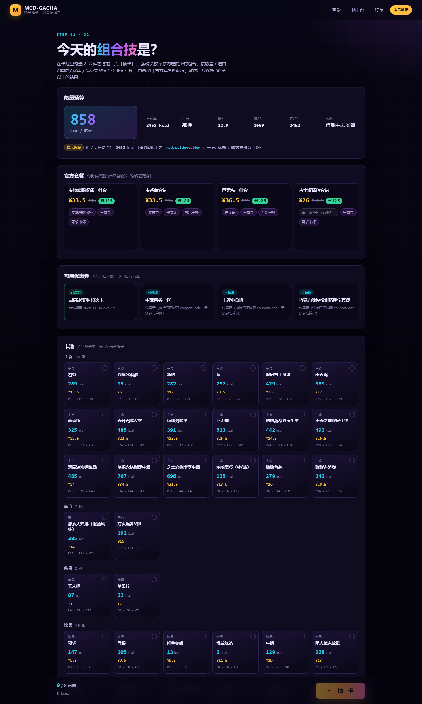
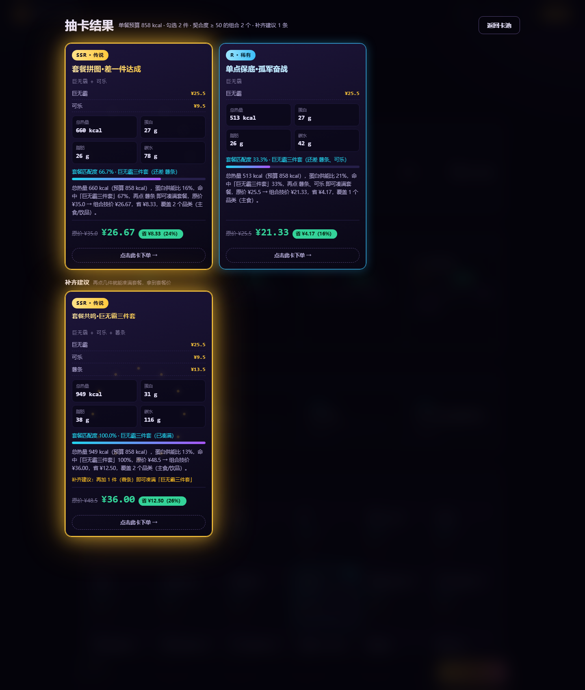
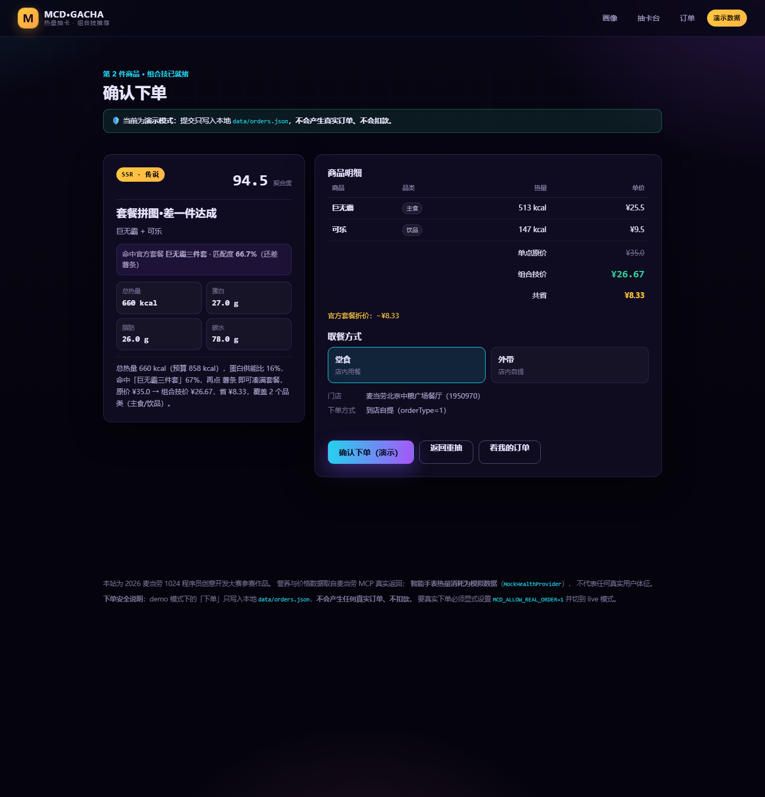
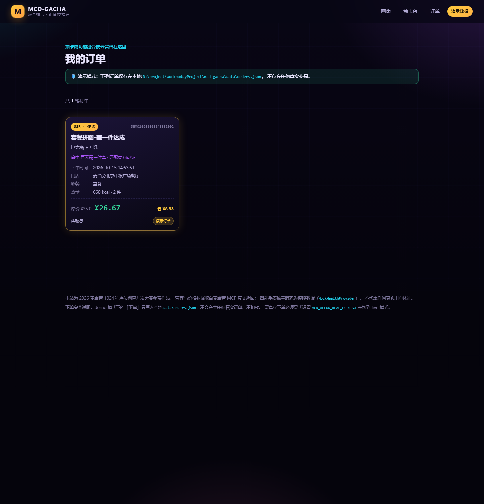

# mcd-gacha · 麦当劳「套餐组合技」抽卡推荐

**把点餐变成游戏。** 输入身高体重 → 结合智能手表日均热量消耗 + 麦当劳优惠券 → 用「抽卡」抽出你这顿最值得点的「组合技」。

## 🚀 Demo 入口（离线、零配置、无网络也能跑）

```bash
pip install -r requirements.txt
python app.py --demo
# 打开 http://127.0.0.1:5000/
```

`--demo` 模式**不连 MCP、不读任何环境变量、不产生任何真实订单**，全部数据来自
`data/fixtures/` 里 26 个 MCP 响应快照（25 个真实抓取 + 1 个明确标注的合成下单骨架）。
智能手表数据为模拟数据，页面已用「演示数据」标签明确标注。

### 成品截图

| 抽卡台（桌面端） | 抽卡结果 |
|---|---|
|  |  |

> 上图即用户点名的场景：勾选「巨无霸 + 可乐」→ SSR「套餐拼图·差一件达成」，
> 套餐匹配度 66.7%，原价 ¥35.0 → 组合技价 ¥26.67；下方补齐建议提示
> 「再加 1 件（薯条）即可凑满巨无霸三件套」。

---

## 1. 这是什么

**把点餐变成游戏。**

一次真实的外卖/到店点餐决策，同时受四个变量约束：**热量预算、营养结构、
优惠券、官方套餐优惠**。人脑很难在几十种单品里同时权衡它们。

`mcd-gacha` 的做法很直接：**把这件麻烦事变成一场抽卡**。

1. 输入身高/体重/性别/年龄/活动量 → Mifflin-St Jeor 算 BMR → TDEE → 目标热量；
2. **若有智能手表日均消耗数据，优先用它替代 TDEE**（更贴近你的真实代谢）；
3. 按 BMI 分档得到日预算，再乘「单餐占比」得到**单餐预算**；
4. 在卡池里勾选 2~8 件想吃的 → 系统**枚举全部组合**，五维打分；
5. 叠加**官方套餐匹配度**加成 → 只保留 ≥50 分的组合 → 按分数倒序，以**稀有度抽卡**
   的形式呈现（SSR / SR / R / N）。

结果卡同时给出 **「原来这几张卡多少钱」 vs 「走组合技多少钱」**，以及
**「再点一件什么，就能凑满官方套餐、把匹配度从 66% 拉到 100%」**。

### 目标用户

- **减脂 / 健身人群**：有热量预算意识，但懒得手算每种搭配的热量与营养结构；
- **价格敏感的常点族**：手里攒了一堆券，却总记不清哪张能用、怎么叠最划算；
- **选择困难的上班族 / 学生**：午休半小时想吃出花样，「抽卡」比翻菜单做决策轻松；
- **麦当劳会员 + 智能手表佩戴者**：手表日均消耗数据让热量预算更贴近真实代谢。

一句话：**想把「今天这顿麦当劳怎么点」交给一个懂热量、懂券、懂套餐的工具的人。**

### 用户点名的示例

> 我单点了一个巨无霸 + 一杯可乐；而当下的套餐券是「巨无霸 + 可乐 + 薯条」三件套。

系统输出：

| 结果 | 稀有度 | 分数 | 套餐匹配度 | 原价 | 组合技价 | 省 |
|---|---|---|---|---|---|---|
| 套餐拼图·差一件达成 | **SSR** | 94.9 | 巨无霸三件套 **66.7%** | ¥35.0 | **¥26.67** | ¥8.33 |
| 单点保底·孤军奋战 | R | 70.8 | 巨无霸三件套 33.3% | ¥25.5 | ¥21.33 | ¥4.17 |

补齐建议：**再加 1 件（薯条）** 即可凑满「巨无霸三件套」，匹配度 100%、SSR、省 ¥12.50。

---

## 2. 五维契合度算法

```
总分 = 100 × (0.35·H + 0.20·P + 0.15·F + 0.20·D + 0.10·C) + 套餐匹配加成(≤40)
封顶 100，总分 < 50 直接丢弃，结果按总分倒序
```

| 维度 | 权重 | 公式 |
|---|---|---|
| 热量匹配 **H** | 0.35 | `clamp(1 − |T_C − T_target| / T_target, 0, 1)` |
| 蛋白匹配 **P** | 0.20 | 供能比 `r = P_C·4 / T_C`；理想区间 `[0.20, 0.35]` 记 1；低于 0.20 按 `r/0.20` 衰减；高于 0.35 按 `1 − (r−0.35)/0.35` 衰减 |
| 脂肪匹配 **F** | 0.15 | 供能比 `f = F_C·9 / T_C`；`f ≤ 0.35` 记 1；否则 `1 − (f−0.35)/0.35` 衰减 |
| 优惠覆盖 **D** | 0.20 | 组合技省下的钱 / 子集原价（券免单 + 套餐折价，clamp 到 [0,1]） |
| 组合完整性 **C** | 0.10 | 覆盖品类数（主食 / 蛋白 / 蔬果 / 饮品）÷ 4 |

| 稀有度 | 分数 |
|---|---|
| **SSR · 传说** | ≥ 90 |
| **SR · 史诗** | ≥ 75 |
| **R · 稀有** | ≥ 60 |
| **N · 普通** | ≥ 50 |

### 2.1 套餐匹配度 M（相对原始需求的关键改造）

原始规则是「恰好命中官方套餐 +5 分」——只有 0 或 1 两种取值。本项目把它**连续化**：

```
M = 子集命中该套餐的件数 / 套餐总件数        ∈ [0, 1]
套餐匹配加成 = M × SETMEAL_BONUS(=40)
```

- 套餐 = 汉堡 + 可乐 + 薯条，勾了汉堡 + 可乐 → `M = 2/3 = 66.7%` → 加成 26.7 分；
- 凑满整套 → `M = 1` → 加成满 40 分。

**为什么必须这么做**：无券、无套餐匹配时，五维理论满分只有 **80 分**（D=0），
永远达不到 SSR 线（90）。把「凑满套餐」做成最高 40 分的正向信号后，
SSR 才在 demo 中变得**可达到**——这正是用户要求的「demo 中更常出现 SSR」。
已由 `test_score_ceiling_without_any_discount_is_80` 与
`test_setmeal_bonus_makes_ssr_reachable` 两个测试固化。

#### 实测稀有度分布

跑 `python tools/measure_rarity.py` 可复现（41 单品 / 7 张套餐 / 4 组画像 × 120 场，
随机种子 `20261014`）：

| 勾选方式 | 前 5 张卡里 SSR 占比 | 出现 SSR 的场次占比 |
|---|---|---|
| 随机乱点 2~5 件（基线） | 2.7% | 4.5% |
| **从官方套餐组成里抽 2~N-1 件**（想凑套餐） | **21.5%** | **51.1%** |

乱点几乎抽不到 SSR、想凑套餐时有一半以上场次能出 SSR —— 这既满足了
「demo 中更常出现 SSR」，又保住了稀有度该有的稀缺感。

### 2.2 单餐预算（`meal_target`）

推荐算法产出的是一次「一餐的量级」（约 300~1500 kcal）。若直接拿**全天预算**
（约 2400 kcal）当 `T_target`，任何单餐组合的 H 都趋近 0，35% 的权重被结构性浪费。

因此引入 **单餐预算 = 日预算 × 单餐占比**（默认 35%，可选 25% / 35% / 45%），
推荐链路一律用 `meal_target` 作为 `T_target`。全天预算仍在页面上展示，
用于说明「这一顿占你今天多少额度」。

### 2.3 套餐折价口径

套餐折价按**件均优惠额**折算：

```
套餐折价 = (套餐优惠额 / 套餐件数) × 命中件数
```

而不是按件均售价折算。后者在只命中 1 件时会得出「三分之一个套餐只要三分之一个价」
这种明显不成立的优惠；件均折算在 `M = 1` 时恰好收敛到套餐真实价。
详见 `test_combo_price_uses_per_item_setmeal_discount` 与
`test_per_item_discount_beats_naive_pro_rata`。

---

## 3. 项目结构

```
mcd-gacha/
├── app.py                    Flask 入口（路由 / 缓存 / --demo|--live|--no-reload）
├── conftest.py               pytest 根配置（把项目根加入 sys.path）
├── requirements.txt
├── README.md                 本文件
├── MCP_INTEGRATION.md        MCP 集成技术文档（入参 schema、返回结构、11 条踩坑）
├── CONTEST_DECLARATION.md    参赛作品原创性与合规声明
├── workbuddy.md              WorkBuddy 完整对话上下文（协作说明 + 逐轮对话记录）
├── mcp-config.example.json   MCP 服务器配置示例（占位，无明文密钥）
├── .env.example              环境变量样例（占位，无明文密钥）
├── .gitignore
├── services/
│   ├── mcp_client.py         ⭐ MCP 调用唯一出口（demo / live 双模式）
│   ├── nutrition.py          伪表格解析 + 菜单 join + 官方套餐组装
│   ├── coupon.py             两类券接口归一化为 Coupon
│   ├── health.py             HealthProvider ABC + MockHealthProvider + 真实接入桩
│   ├── profile.py            BMR / BMI / TDEE / 目标热量 / 单餐预算
│   ├── recommender.py        ⭐ 五维契合度 + 套餐匹配度 + 组合技命名
│   ├── scheduler.py          APScheduler 定时拉券（三重守卫防重复启动）
│   └── order.py              下单归一化 + 本地订单持久化
├── templates/                base.html / index.html / gacha.html / order_confirm.html / orders.html（全中文）
├── static/css/style.css      设计令牌 + 极光背景 + 纯 CSS 3D 翻卡 + 稀有度光效
├── static/js/gacha.js        仅 fetch + DOM，动画全部交给 CSS
├── static/js/order.js        下单确认页交互
├── docs/                     成品截图（README 引用）
├── data/
│   ├── fixtures/             26 个 MCP 响应快照（24 个真实抓取 + 2 个订单相关骨架/脱敏样本）
│   ├── health.json           模拟手表数据（缺失时按日期种子自动生成，可复现）
│   └── cache/coupons.json    定时任务产出的券快照
├── tools/
│   ├── accept_stage3.py      阶段 3 验收脚本（定时任务 + 健康数据）
│   ├── measure_rarity.py     稀有度分布实测脚本（给 README 里的数字提供依据）
│   ├── build_workbuddy_md.py 把 WorkBuddy 导出的对话数据转成 workbuddy.md（可复查重跑）
│   └── shoot_ui.js           无头 Chrome + CDP 截图与响应式体检脚本
└── tests/                    185 个用例
```

技术栈刻意保持极简：**Flask + Jinja2 + 原生 CSS / JS**，不引入 React / Vue /
Tailwind CDN，无任何前端构建步骤，离线可跑。

---

## 4. 运行方式

```bash
# 离线 demo（默认，推荐评委使用）
python app.py --demo

# 关闭热重载（推荐：避免定时任务在父进程里被重复拉起）
python app.py --demo --no-reload

# 连接真实 MCP 服务器（需要 MCP 运行环境与凭据）
python app.py --live

# 指定端口
python app.py --demo --port 8080
```

| 路由 | 说明 |
|---|---|
| `GET  /` | 表单页：身高 / 体重 / 性别 / 年龄 / 活动量 / 单餐占比 / 城市 / 门店 |
| `POST /profile` | 写入 session 后跳转 `/gacha` |
| `GET  /gacha` | 抽卡主界面：热量预算 + 官方套餐 + 优惠券 + 四分类卡池 |
| `POST /api/recommend` | 入参 `{"ids": [...], "limit": 5}` → 组合技结果 + 补齐建议 |
| `GET  /api/coupons` | 当前券列表 |
| `GET  /api/catalog` | 卡池单品 |
| `GET  /health` | `{"status":"ok","mcp":"demo","scheduler":"running","next_run":"..."}` |

### 环境变量（全部可选）

| 变量 | 默认 | 说明 |
|---|---|---|
| `MCD_SECRET_KEY` | `mcd-gacha-demo-secret` | Flask session 签名密钥；生产部署请注入真实值 |
| `MCD_MCP_COMMAND` | — | `--live` 模式下 MCP 服务器的启动命令 |
| `MCD_MCP_TOKEN` | — | `--live` 模式下访问 MCP 的凭据 |
| `MCD_STORE_CODE` | `1950970` | 默认门店（北京中粮广场） |
| `MCD_SCHEDULER_ALWAYS` | — | 置 `1` 时强制当前进程持有定时任务（部署到 gunicorn 等非 Werkzeug 环境时用） |

**仓库内不含任何明文密钥。** Token / Key 一律只从环境变量读取，
`.env.example` 只有占位符。

---

## 5. 定时任务：每天 08:00 拉券

`services/scheduler.py` 用 APScheduler 的 `BackgroundScheduler`，每天 08:00 调用一次
`query-store-coupons`，把结果写入 `data/cache/coupons.json`。

### ⚠️ Flask 热重载会重复启动定时任务

Werkzeug 的开发者服务器默认开启热重载：它会**把模块执行两遍**（父进程 + 工作子进程），
于是 `BackgroundScheduler` 被启动两次 → 每天拉两次券，甚至报
`maximum number of running instances reached`。

本项目用**三重守卫**解决：

1. `services/scheduler.should_own_scheduler(use_reloader=...)`
   —— 关热重载时由主进程持有；开热重载时父进程**主动放弃**，
   只有工作子进程（`WERKZEUG_RUN_MAIN == "true"`）才持有；
2. 模块级 `_scheduler` **单例** —— 重复调用 `start_scheduler()` 无副作用；
3. `app.py --no-reload` —— 显式关闭热重载的逃生口。

启动日志会直接打印当前进程的判定结果（`定时任务 = running` / `delegated`），
`GET /health` 也会返回 `scheduler` 与 `next_run`，便于确认只有一份在跑。

### 验收脚本

```bash
python tools/accept_stage3.py --sec 5 --rounds 3   # 把 cron 临时改成每 5 秒
```

它会①手动刷新一次并核对落盘、②把任务改到秒级观察 `coupons.json` 的
`refreshed_at` 被持续重写、③打印近 7 天手表消耗与日均值。

---

## 6. 下单与订单：把抽卡结果保存下来

抽到满意的组合技后，点击结果卡进入**下单确认页**，选择取餐方式（堂食 / 外带），
确认价格与门店后提交。

- **demo 模式**：订单只写入本地 `data/orders.json`，**不产生任何真实交易**。
  页面和订单列表都有「演示订单」角标，订单号统一以 `DEMO` 开头，肉眼即可区分。
- **live 模式**：真实调用 MCP `create-order`。但默认被安全闸拦截，必须显式设置
  `MCD_ALLOW_REAL_ORDER=1` 才会放行；忘记设置只会收到 403 提示，不会误下单。

新增页面与接口：

| 入口 | 说明 |
|---|---|
| `GET /order/new?ids=1100,9900008751` | 下单确认页，服务端对传入商品重算一次组合技 |
| `POST /api/order` | 下单，返回 `{order_id, redirect}` |
| `GET /orders` | 订单列表（抽卡成功后的结果留档） |
| `GET /api/orders` | 订单列表 JSON |

订单记录保留**稀有度**和**组合技名**，所以订单列表看起来就像「我的 SSR 收藏夹」：

| 订单页 | 列表页 |
|---|---|
|  |  |

---

## 7. 智能手表数据：怎么换成真实的

`services/health.py` 把「热量消耗数据源」抽象成 `HealthProvider`：

```python
class HealthProvider(ABC):
    name: str = "base"

    @abstractmethod
    def get_daily_burn(self, days: int = 7) -> list[DailyBurn]:
        """返回最近 days 天（含今天）的每日消耗，按日期升序。"""
```

- `MockHealthProvider`（默认）：读 `data/health.json`；文件缺失时生成过去 7 天
  1800–2600 kcal 的模拟数据并落盘。**随机种子 = 日期 + 固定盐**，因此同一天多次运行
  结果稳定可复现。`MockHealthProvider` 还提供 `average_burn(days)`。
- `AppleHealthProvider` / `GoogleFitProvider`：**未实现的桩**，调用会抛出带接入指引的
  `NotImplementedError`。

**真实接入只需要实现一个 `HealthProvider` 子类**，其余代码零改动：

```python
class MyWatchProvider(HealthProvider):
    name = "my_watch"

    def get_daily_burn(self, days: int = 7) -> list[DailyBurn]:
        rows = my_backend.query(days)          # 你的数据源
        return [DailyBurn(date=r["d"], calories=r["kcal"]) for r in rows]

# 然后： from services.health import get_provider
#        provider = get_provider("my_watch")
```

现实约束（如实说明）：Apple Health / Google Fit / 华为运动健康**都没有公开且稳定的
直接读取接口**，必须先在自己的 App 侧用 HealthKit / Fitness API 做每日汇总，
再把汇总结果喂给本 Provider。这是本项目默认使用 Mock 的原因，**不是偷懒**。
接入思路分别写在两个桩类的 docstring 里。

**UI 上所有手表数据都带「演示数据」标签**，不会让评委或用户误以为是真实读数。

---

## 8. 测试

```bash
python -m pytest -q          # 185 passed
```

| 文件 | 覆盖 |
|---|---|
| `tests/test_parsers.py` | 伪表格解析、名称归一化、四分类、券解析、菜单/套餐 join |
| `tests/test_profile.py` | BMR / BMI 分档 / TDEE / 手表优先 / 单餐预算 |
| `tests/test_health.py` | Mock 生成与可复现性、损坏文件容错、真实接入桩抛错 |
| `tests/test_recommender.py` | 五维各维度、稀有度边界、套餐匹配度、价格口径、补齐建议、demo 端到端 |
| `tests/test_app.py` | 路由与模板渲染、API 契约、定时任务三重守卫 |

`tests/test_app.py` 里有一类专门的「防静默失败」断言：模板引用了不存在的属性时
Jinja2 会静默渲染成空，页面不报错但会留下空白，因此测试会检查页面上不允许出现
空的 `<dd>`、也不允许残留未渲染的 `{{ }}`。

---

## 9. 合规与安全

`.env.example` 与 `mcp-config.example.json` 内**只有占位符**，仓库中不含任何明文
Token / Key / 手机号 / 地址。所有凭据只从环境变量读取。

`--demo` 模式**硬隔离**所有有副作用的接口。以下工具会改变真实世界状态，demo 模式
绝不调用，本项目也从未产生任何真实订单、地址或积分兑换：

`auto-bind-coupons`、`create-order`、`cancel-order`、`mall-create-order`、
`delivery-create-address`、`party-order-create`、`draw-lottery`。

`draw-lottery` 涉及积分扣减，官方要求用户显式确认，本项目**只做只读展示**。

数据来源、接口能力边界与 11 条踩坑记录见 `MCP_INTEGRATION.md`；
原创性与合规声明见 `CONTEST_DECLARATION.md`。

---

## 10. 已知限制

- **菜单随门店变化**：demo 的卡池只覆盖门店 `1950970`（北京中粮广场）的菜单；
  换门店需要重新缓存菜单。门店选择目前只用于展示，不改变卡池。
- **部分套餐商品不在门店菜单**：`1010 / 521952 / 515106 / 1000 / 3071` 在门店菜单里
  买不到，这些套餐的匹配度上限低于 100%，也**不会**被推荐为「补齐建议」（凑不齐）。
- **两类券接口无法算价**：`available-coupons` / `query-my-coupons` 返回 Markdown 且
  **不返回 couponId / couponCode**，因此只能展示标题、无法参与算价。唯一「三全」
  （couponId + couponCode + products）的接口是 `query-store-coupons`，
  这也正是本项目以**门店券为准**的原因。
- **外送链路未验证**：本账号配送地址为空，`beType=2/6` 链路无法跑通，
  主链路锁定**到店自提**（`beType=1`）。
- **别名表未做全量**：只覆盖 demo 会用到的约 30 个单品，未做全量 160 条映射。

---

## 11. 自检清单

| 检查项 | 结果 |
|---|---|
| `python app.py --demo` 无网络能跑通 | ✅ 26 个 fixture 本地回放，零外部依赖 |
| 契合度 < 50 的组合不出现 | ✅ `SCORE_FLOOR = 50.0`，`test_recommend_filters_below_50` |
| 结果按分数倒序 | ✅ `test_recommend_results_sorted_desc_and_all_above_floor` |
| 稀有度分级一致 | ✅ 90 / 75 / 60 / 50 四档，前后端同源 `RARITY_TABLE` |
| MCP 调用只在 `services/mcp_client.py` | ✅ 其余模块只调 `mcp_client.fetch_*` / `calculate_price` / `create_order` / `fetch_order_list` 等便捷访问器 |
| 无明文密钥 | ✅ 全部走环境变量，示例文件仅有占位符 |
| `README` 顶部有 Demo 入口 | ✅ 本文档第 5~8 行 |
| demo 下单不产生真实订单 | ✅ 订单号以 `DEMO` 开头，只写 `data/orders.json`，`MCD_ALLOW_REAL_ORDER` 默认未开启 |
| 真实下单需显式授权 | ✅ live 模式下 `create-order` 默认被 `WriteBlocked` 拦截，必须设置 `MCD_ALLOW_REAL_ORDER=1` |
| `pytest` 全绿 | ✅ **185 passed** |
| 合规文件齐全 | ✅ `README.md` / `CONTEST_DECLARATION.md` / `mcp-config.example.json` / `workbuddy.md` / `.env.example` / `.gitignore` |

---

## 12. 许可

本项目为 **2026 麦当劳 1024 程序员创意开发大赛**参赛作品，仅供赛事评审与学习交流使用。
「麦当劳」「McDonald's」及相关商品名称、商标归其各自权利人所有，本项目与之无从属关系。
